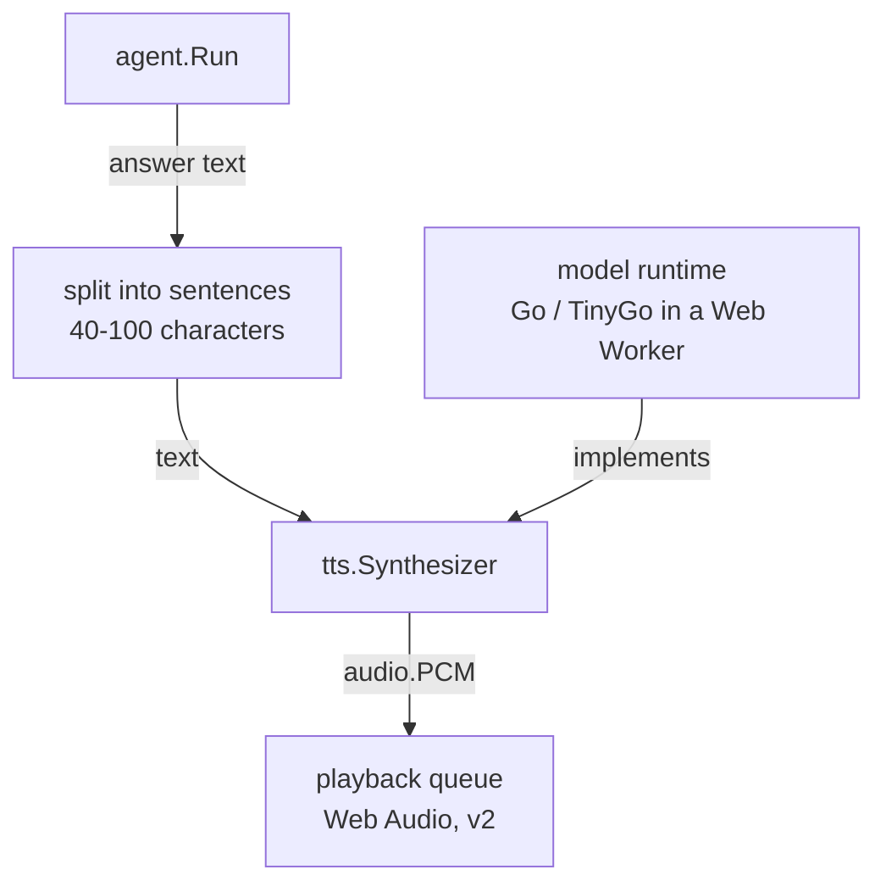

# Architecture — `webtyp/tts`

## What this is

The **text-to-speech** contract: an interface that turns text into spoken audio
(`audio.PCM`). It is also called speech synthesis.

You meet it in version 2 of the webtyp agent, when the agent's answer is spoken aloud.
Version 1 is text only, and the contract exists now so the pipeline is wired from the start.

It exists as a contract, separate from any model, so that the application and the agent do
not change when the voice or model does.

## The model that will implement it (version 2, open)

The implementation runs **in the browser, in Go compiled with TinyGo, inside a Web Worker**.
This is an open-source project, and the stated goal is **the voice that sounds best and uses
the fewest resources**, decided by listening and by measuring the real-time factor under
TinyGo/WASM. [TEXT_TO_SPEECH_BROWSER_MODELS.md](TEXT_TO_SPEECH_BROWSER_MODELS.md) compares the
candidates. Its runtime recommendations (ONNX Runtime Web) assume JavaScript, and webtyp does
not use that route. What carries over:

| Candidate | Size | Spanish | What a Go implementation needs |
|---|---|---|---|
| **Piper** (VITS, medium) | ~60 MB | voices `es_ES-davefx`, `es_ES-carlfm`, `es_MX-ald` | 1-D convolutions, transposed convolutions, normalizing flows |
| **Kokoro-82M** (StyleTTS2 + iSTFTNet) | ~80 MB int8 | a few Spanish voices | convolutions, LSTM, inverse STFT |
| **KittenTTS nano** | ~25 MB | English only today | ruled out for Spanish until that changes |

All of them need operators that `webtyp/transformer` does not have yet (convolutions). The
text encoders are transformer-like and reuse its kernels.

### Phonemes, and a licence to check

These models do not read letters. They read **phonemes** (the sounds of the language, written
in IPA), produced by a grapheme-to-phoneme step. Piper and Kokoro use **espeak-ng** for that
step, and espeak-ng is licensed under **GPL-3**. The webtyp libraries are MIT. Shipping
espeak-ng inside the same binary would put the combined work under GPL terms.

Spanish spelling is highly regular. A rule-based grapheme-to-phoneme converter written in Go,
which outputs the same IPA symbols espeak-ng produces for Spanish, is a small, self-contained
piece. It keeps the stack pure Go and MIT. This is an open decision in the
[ecosystem master plan](https://github.com/webtyp/agent/blob/main/docs/AGENT_ECOSYSTEM_MASTER_PLAN.md).
